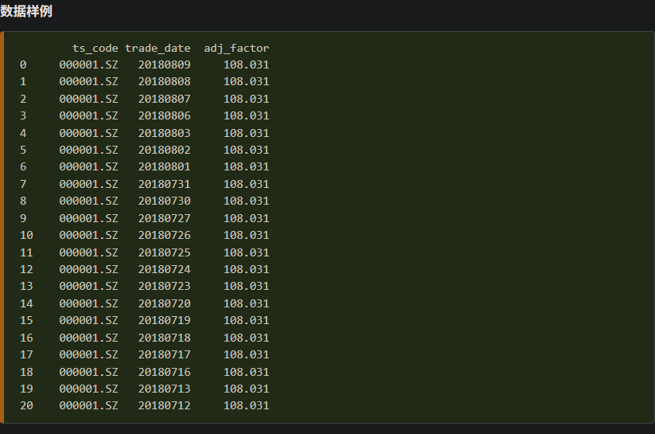

# 复权因子来源

> ← 返回 [架构说明](architecture.md)
>
> 记录日期：2026-10-11
> 关联：[adjustment-principle.md](adjustment-principle.md)（复权原理与公式）·
> [tushare-reference.md](tushare-reference.md)（数据源全貌与定价）·
> [formulas.md](formulas.md)（项目在跑的公式）

本文回答一个具体问题：**要算复权，需要调 Tushare 的哪些接口。**

原理和公式在 `adjustment-principle.md`，本文只讲取数路径的取舍。

---

## 0. 一个前提

**Tushare 没有「前复权价 / 后复权价」这种接口。**

官方只给**因子**，前后复权都得自己合成。所以「用哪些接口算复权」的实质是
**「用哪些接口拿因子」**，而不是「调哪个接口要复权价」。

两条黑盒路线（`pro_bar`）直接给成品价，但那拿不到因子、无法校验，见 §6。

---

## 1. 路径 1：官方复权因子

**接口**：[复权因子 `adj_factor`](https://tushare.pro/document/2?doc_id=28)（doc_id=28）

```python
pro.adj_factor(ts_code='600570.SH')                 # 单股全历史
pro.adj_factor(ts_code='', trade_date='20210716')   # 单日全部股票
```

输出只有三个字段：`ts_code` / `trade_date` / `adj_factor`。

**官方数据样例**（平安银行 `000001.SZ` 2018 年 7-8 月）：



注意 20 行全部是同一个 `108.031` —— 因子只在除权日才变，日常是阶梯状的平台。

**两个必须知道的事实：**

1. **权限要求 2000 积分起**，官方原文「积分要求：2000积分起，5000以上可高频调取」。
   这是**权限门槛**，不是限流问题 —— 当前账号调不到。
2. **可以按日期批量**。官方原话「可以提取单只股票全部历史复权因子，
   **也可以提取单日全部股票的复权因子**」。

**可行性**：❌ 权限不够。即便升到 2000 积分，1次/小时 × 约 5400 个交易日
≈ 225 天，全市场仍不可得。

### 1.1 拿到因子之后怎么用

**直接乘得到的是「后复权」；要前复权还得再除一次。**

```
后复权 hfq = 不复权价 × adj_factor
前复权 qfq = 不复权价 × adj_factor ÷ adj_factor_max
```

**`adj_factor_max` 取当前最新交易日那一行的值** —— 除的是它，不是当前这行。

**`adj_factor` 是不归一的累计因子**（官方样例里平安银行 2018 年 8 月全是 `108.031`，
量级就说明了一切）。直接乘的结果是「把上市至今的累计涨跌全堆进去」：

```
8.70 × 108.031 ≈ 940
```

这个数**没错**，只是起点不等于真实价 —— 那是后复权价的正常形态。

| | 最新那根的价格 | 用途 |
|---|---|---|
| 后复权 | 被抬高成累计涨幅后的值 | 算累计涨跌幅 |
| **前复权** | **等于真实市价** | 图表默认，跟盘面对得上 |

**图表要用第二条公式**，否则图上最新价和盘面差 100 倍。

> 注意 `adj_factor_max` 的分母取的是**当前**最后一个除权日之后的累积因子。
> 只有新增的那天**本身是除权日**时它才会变，普通交易日新增对历史 qfq **零影响**。
> 但 qfq 仍然要**读时现算**、不能落库：落库那一刻的分母就固化了，
> 将来新增除权日时你无法知道哪些历史行需要重算。

---

## 2. 路径 2：`pre_close` 自算（**主推**）

**接口**：[历史日线 `daily`](https://tushare.pro/document/2?doc_id=27)（doc_id=27）

```python
pro.daily(ts_code='600570.SH')     # 取 ts_code, trade_date, close, pre_close
```

```
gap_ratio   = pre_close ÷ 前一根 close        （除权缺口，比值 < 1）
cum_factor  = 从上市首日 1.0 起，每遇除权日乘一次 gap_ratio 的**倒数**

hfq_price   = raw_price × cum_factor
qfq_price   = raw_price × cum_factor ÷ cum_factor_max
```

⚠️ **`cum_factor` 连乘的是缺口的倒数（`前一根 close ÷ pre_close`），不是缺口本身。**
取错方向 `cum_factor` 会随除权**递减**，`hfq_price = raw_price × cum_factor` 于是让
后复权在每个除权日**向下断**，与前复权正好反过来。

实测（恒生电子 2021-07-16）：`pre_close=61.72`、前一根 `close=86.50`，
缺口 `61.72/86.50 = 0.7135`，倒数 `= 1.4015`。实现见 `market.py` 的
`_EX_RATIOS_SQL`（`prev_close / pre_close AS ratio`）与 `Adjustment.factor`。
另见 [adjustment-principle.md](adjustment-principle.md) §3。

官方对 `pre_close` 的描述直接就是「昨收价【**除权价**】」——括号里已点明
它不是原始昨收。

**可行性**：✅ **唯一能全市场规模化的路径。**

| | |
|---|---|
| 频次 | 50 次/分钟、8000 次/天 |
| 额外调用数 | **0** —— `pre_close` 已随日线落在 `kline_day` |
| 额外存储 | **不需要**，输入就在库里 |

这正是 `db.py` 把 `pre_close` 列成必落库字段的原因：它一旦丢了，只能重拉全历史才能补，
属于**不可逆的数据损失**。

---

## 3. 路径 3：分红送股明细（交叉校验）

**接口**：[分红送股 `dividend`](https://tushare.pro/document/2?doc_id=103)（doc_id=103）
**＋** 路径 2 的 `daily`（光有比例算不出除权价，必须配价格）

```python
pro.dividend(ts_code='600570.SH')
```

### 3.1 它返回的是「方案的多阶段快照」，不是除权事件表

恒生电子实测：返回 **80 行，其中只有 27 行 `ex_date` 非空**。其余 53 行是同一个
分红方案的中间态（预案 / 股东提议 / 预披露 / 股东大会通过 / 实施）。

**必须按 `ex_date` 非空过滤**，否则会把没实施的方案当成除权事件。

### 3.2 去重后落库 47 行，其中 23 条是真正的除权除息

27 行里有 4 组重复（`20210716` / `20220818` / `20240611` / `20250606` 各出现两次，
差别只在 `ann_date` —— 同一方案被公告了两次）。

`stock_xdxr` 主键是 `(code, ex_date, category)`，去重靠 `INSERT IGNORE`，
但 `sync_tushare.py` **只按 `ex_date` 非空过滤、其余全插**，所以表里留了股本变化
等非除权除息记录：恒生电子实测 **47 行**（46 个不同 `ex_date`）。
按 `cash_dividend > 0` 筛才得 **23 条**，与 `adjustment-principle.md` 记的
「恒生电子历史上共有 23 个除权断点」完全吻合 —— 这是一次独立的交叉验证。

⚠️ 读表时记得区分：47 是表行数，23 才是除权断点数。

### 3.3 官方共 16 个字段，默认只显示 14 个

多出的 `base_date`（基准日）、`base_share`（基准股本，万）默认显示为 N，
不指定 `fields` 就拿不到。**`base_share` 正好能补上 `stock_xdxr` 缺的股本信息。**

### 3.4 字段语义（注意与现有代码不符）

| 字段 | 官方描述 | `sync_tushare.py` 现状 |
|---|---|---|
| `stk_div` | 每股**送转** | ✅ 已用 |
| `stk_bo_rate` | 每股**送股**比例 | ❌ **被忽略** |
| `stk_co_rate` | 每股**转增**比例 | ⚠️ 被当成「配股」写进 `allot_ratio` |
| `cash_div` | 每股分红（**税后**） | 未用 |
| `cash_div_tax` | 每股分红（**税前**） | ✅ 已用（正确，除权价按税前算） |
| `record_date` | 股权登记日 | 表里无列 |
| `pay_date` | 派息日 | 表里无列 |
| `div_listdate` | 红股上市日 | 表里无列 |
| `imp_ann_date` | 实施公告日 | 表里无列 |

**配股在 Tushare 里没有独立字段**，`stock_xdxr.allot_ratio` / `allot_price` 拿不到。

### 3.5 可行性

⚠️ 单股可做，全市场不可行。**实测限流 1 次/小时**（注意：`tushare-reference.md`
记的是 1次/分钟，是错的）→ 5225 只需 218 天。

定位是**交叉校验**，不是主路径。`stock_xdxr` 是否填充**不影响**复权计算——
因子只由 `kline_day.pre_close` 现算（该表现已有 47 行，其中 23 条为真除权断点）。

---

## 4. 路径 4：港股 / 美股 / ETF

A 股用不上，列出备查：

| 品种 | 链接 |
|---|---|
| 港股复权因子 | https://tushare.pro/document/2?doc_id=401 |
| 美股复权因子 | https://tushare.pro/document/2?doc_id=402 |
| ETF复权因子 | https://tushare.pro/document/2?doc_id=199 |

---

## 5. 汇总

| 路径 | 接口 | 频次 / 权限 | 全市场可行 |
|---|---|---|---|
| 1 官方因子 | [adj_factor · 28](https://tushare.pro/document/2?doc_id=28) | 1次/小时 · **需 2000 积分** | ❌ 权限不够 |
| **2 自算（主推）** | [daily · 27](https://tushare.pro/document/2?doc_id=27) | 50次/分钟 | ✅ **零额外调用** |
| 3 校验 | [dividend · 103](https://tushare.pro/document/2?doc_id=103) + daily | 1次/小时 | ❌ 单股 / 抽样 |
| 4 港美股 / ETF | [401](https://tushare.pro/document/2?doc_id=401) · [402](https://tushare.pro/document/2?doc_id=402) · [199](https://tushare.pro/document/2?doc_id=199) | — | A 股无关 |

**结论：本项目主路径只需要路径 2 一个接口，而它不需要额外调用 —— 数据已经在库里了。**

---

## 6. 黑盒路线（不推荐）

| 接口 | 链接 |
|---|---|
| 通用行情接口 `pro_bar` | https://tushare.pro/document/2?doc_id=109 |
| 复权行情 | https://tushare.pro/document/2?doc_id=146 |

`pro_bar` 支持 `adj='qfq'/'hfq'`，直接给成品复权价。但只给价、**拿不到因子、
无法交叉校验**，且限流档位未实测。

---

## 7. 核对官网时发现的四处错误

| 位置 | 原记载 | 实际 |
|---|---|---|
| `tushare-reference.md` §4.5.1 | `dividend` 1次/分钟 | **1次/小时**（2026-10-10 实测报错确认） |
| `tushare-reference.md` §4.5.1 | `adj_factor`「不能批量」 | **可按 `trade_date` 批量**；真正卡点是 2000 积分权限 |
| `sync_tushare.py` | `stk_co_rate` = 配股 | 官方定义是**转增**；配股无此字段 |
| `sync_tushare.py` | dividend 取 14 字段 | 官方共 **16 个**，多 `base_date` / `base_share` |

另有一条待核对：`dividend` 官方标注需 2000 积分，但用项目 token（文档记为 170 积分）
**实测调通**了。要么账号实际积分更高，要么 Tushare 已放宽。

---

## 8. 链接总表

| 用途 | 链接 |
|---|---|
| 历史日线 | https://tushare.pro/document/2?doc_id=27 |
| 复权因子 | https://tushare.pro/document/2?doc_id=28 |
| 分红送股 | https://tushare.pro/document/2?doc_id=103 |
| 通用行情接口 | https://tushare.pro/document/2?doc_id=109 |
| 复权行情 | https://tushare.pro/document/2?doc_id=146 |
| 港股复权因子 | https://tushare.pro/document/2?doc_id=401 |
| 美股复权因子 | https://tushare.pro/document/2?doc_id=402 |
| ETF复权因子 | https://tushare.pro/document/2?doc_id=199 |
| 限流说明 | https://tushare.pro/document/1?doc_id=108 |
| 积分获取办法 | https://tushare.pro/document/1?doc_id=13 |
| 数据接口总目录 | https://tushare.pro/document/2 |
